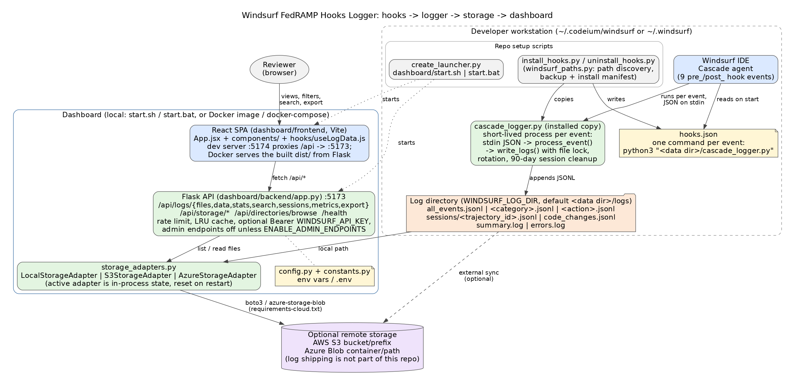

# Architecture

Windsurf FedRAMP Hooks Logger records every Windsurf Cascade hook event as JSONL on the developer's machine and gives reviewers a dashboard to browse, filter, search and export those logs, from the local log directory or from S3 / Azure Blob Storage.

Diagram source: [`diagrams/architecture.dot`](diagrams/architecture.dot) (Graphviz). After editing it, run `docs/diagrams/render.sh` to regenerate [`architecture.png`](diagrams/architecture.png) and [`architecture.svg`](diagrams/architecture.svg). Rendering needs Graphviz (`sudo apt-get install -y graphviz fonts-dejavu` or `brew install graphviz`).

## Components

| Component | Files | Role |
|-----------|-------|------|
| Hook installer | `install_hooks.py`, `uninstall_hooks.py`, `windsurf_paths.py` | Finds the Windsurf data directory (`~/.codeium/windsurf`, falling back to `~/.windsurf`), copies `cascade_logger.py` into it, writes `hooks.json`, and records backups in `windsurf-logger-install-manifest.json` so uninstall can restore the previous state. |
| Hook config | `hooks.json` (template only) | The installer generates the real file with `generate_hooks_config()`: each of the 9 events runs `python3 "<data dir>/cascade_logger.py"` (`python` on Windows). |
| Logger | `cascade_logger.py`, `constants.py` | One short-lived process per hook event. Reads the event JSON from stdin, maps the action to a category and phase (`constants.py`), extracts event-specific fields, and appends the entry to several JSONL files under an exclusive file lock. The installed copy runs outside the repo, so it carries fallback copies of the path discovery and event maps. |
| Log directory | `WINDSURF_LOG_DIR`, default `<data dir>/logs` | `all_events.jsonl`, `<category>.jsonl`, `<action>.jsonl`, `sessions/<trajectory_id>.jsonl`, `code_changes.jsonl`, `summary.log`, `errors.log`. Files rotate at `WINDSURF_LOG_MAX_SIZE` (50 MB, keeping `WINDSURF_LOG_MAX_FILES`=5); a once-a-day pass deletes session logs older than `WINDSURF_LOG_RETENTION_DAYS` (90). |
| Dashboard API | `dashboard/backend/app.py`, `config.py` | Flask app on port 5173. Serves `/api/logs/*` (files, data, stats, search, sessions, metrics, export), `/api/storage/*`, `/api/directories/browse`, `/api/config/*`, `/health` and `/api/health`, and the built SPA from `dashboard/frontend/dist`. |
| Storage adapters | `dashboard/backend/storage_adapters.py` | `LocalStorageAdapter`, `S3StorageAdapter` (boto3) and `AzureStorageAdapter` (azure-storage-blob, optional azure-identity). Remote files are downloaded to a temp directory before parsing. The active adapter is module-level state set by `POST /api/storage/configure`; it is not persisted and resets to local on restart. |
| Dashboard UI | `dashboard/frontend/` | React 18 + Vite + Tailwind. `hooks/useLogData.js` holds all API calls and filter state; `components/` holds the views (Workflow, Timeline, List, Metrics), the sidebar and filters, and `DirectoryPicker.jsx` (local directory browser plus the S3 / Azure source tabs). |
| Launchers | `dashboard/start.sh`, `dashboard/start.bat`, `create_launcher.py`, `create-desktop-launcher.sh`, `Windsurf Logger Dashboard.{command,bat}` | Create `dashboard/backend/venv`, install backend and frontend dependencies, start Flask on 5173 and the Vite dev server on 5174 (which proxies `/api` to 5173), and open the browser. |
| Container | `Dockerfile`, `docker-compose.yml`, `requirements.lock` | Multi-stage build: Node 20 builds the SPA, then a Python 3.11 image runs gunicorn (2 workers, 4 threads) on 5173 as a non-root user, serving API and SPA from one port. Compose mounts `./logs` at `/app/logs`. The image installs only `requirements.lock`, so S3 / Azure need `requirements-cloud.txt` added. |

## Flows

### 1. Capture: hook event to log files

1. Windsurf reads `hooks.json` at startup (restart Windsurf after install).
2. For each Cascade action (`pre_user_prompt`, `pre_/post_read_code`, `pre_/post_write_code`, `pre_/post_run_command`, `pre_/post_mcp_tool_use`) Windsurf runs the logger with the event JSON on stdin (`agent_action_name`, `trajectory_id`, `execution_id`, `timestamp`, `tool_info`).
3. `process_event()` builds the entry: `event_id`, category, phase, system info (user, host, platform), event-specific `data` (prompt stats, file info, edit line deltas, command name/args, MCP server/tool), and the raw `tool_info`. Long content is truncated at `WINDSURF_MAX_CONTENT_LENGTH`.
4. `write_logs()` appends the same line to the master, category, action and session files (and `code_changes.jsonl` for writes with edits), then a human-readable block to `summary.log`. Failures go to `errors.log`; the hook never blocks Cascade (`show_output: false`).

### 2. Review: dashboard

1. The SPA loads `/api/config/defaults` for the default log directory, then calls `/api/logs/files`, `/stats`, `/metrics`, `/sessions` and `/data` for that directory.
2. Filters (category, user, session, date range) and text search re-query `/api/logs/data`; regex search uses `/api/logs/search`. Export uses `/api/logs/export`.
3. The backend validates local paths against `ALLOWED_BROWSE_PATHS` (repo dir, log dir, plus `WINDSURF_ALLOWED_PATHS`), caches parsed results in an LRU cache (`WINDSURF_CACHE_TTL`), and rate-limits per client IP.

### 3. Remote storage

1. In the directory picker, choose AWS S3 or Azure Blob and enter bucket/prefix or container/path (credentials can come from the form or from `.env`; `/api/config/env-info` reports which env credentials exist).
2. `POST /api/storage/test` checks the connection; `POST /api/storage/configure` activates the adapter and clears the cache. Log endpoints then read through the adapter (`s3://` / `azure://` directories).
3. This repo does not ship logs to the cloud. Getting `<data dir>/logs` into the bucket or container is an external sync job.

## Security controls

- Flask binds to `127.0.0.1` by default; the Dockerfile sets `FLASK_HOST=0.0.0.0` for the container.
- `WINDSURF_API_KEY` set: every `/api/` route except `/api/health` needs `Authorization: Bearer <key>` (constant-time compare), except browser requests from an origin in `WINDSURF_CORS_ORIGINS` or a same-origin `Sec-Fetch-*` fetch from the bundled SPA. Unset: the API is open and a warning is logged.
- `/api/config/restart-backend`, `/reveal-env` and `/open-env` spawn OS processes and return 403 unless `ENABLE_ADMIN_ENDPOINTS=true`.
- Session file names are sanitized from `trajectory_id`; `.gitignore` excludes `*.jsonl`, `*.log` and `logs/` so captured prompts are not committed.

## Configuration

All settings are environment variables (a `.env` file is supported); see [`.env.example`](../.env.example) for the full list and defaults. The main ones are `WINDSURF_LOG_DIR`, `FLASK_HOST` / `FLASK_PORT`, `WINDSURF_API_KEY`, `WINDSURF_CORS_ORIGINS`, `ENABLE_ADMIN_ENDPOINTS`, the rotation settings above, and the `AWS_*` / `AZURE_STORAGE_*` credentials.

## Tests

| Suite | Command | Covers |
|-------|---------|--------|
| Python | `pip install -r requirements.lock pytest && pytest` (from the repo root) | logger processing, rotation and writes; Flask endpoints and auth; storage adapters; install and path discovery |
| Frontend | `cd dashboard/frontend && npm ci && npm test` | `App` and component rendering (Vitest + Testing Library, jsdom) |

There is no CI workflow in the repo; run both suites locally.
